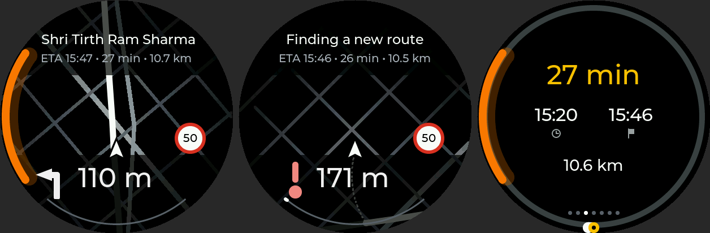
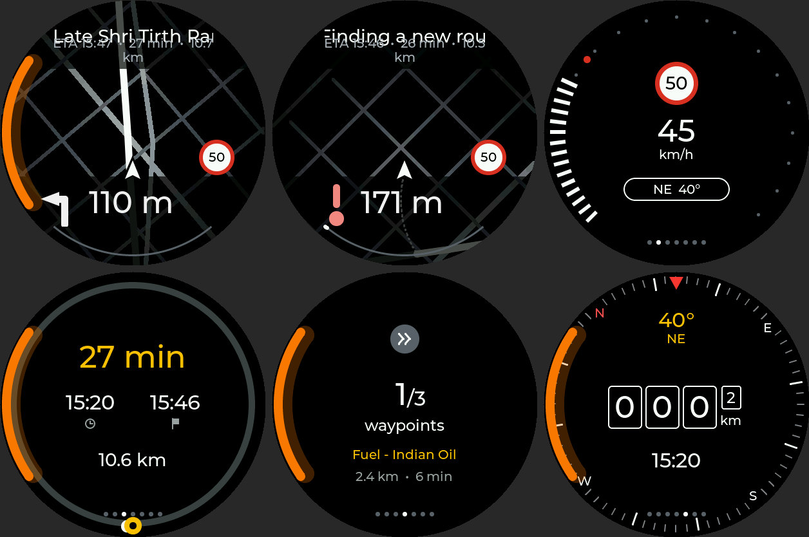
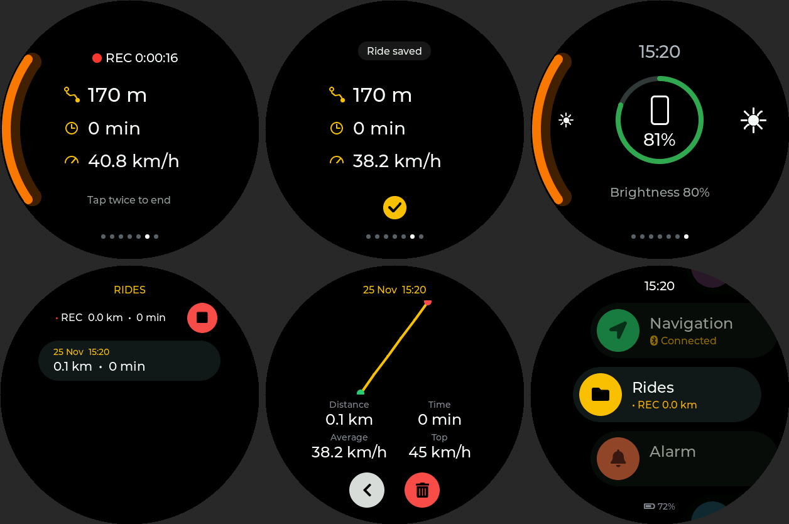
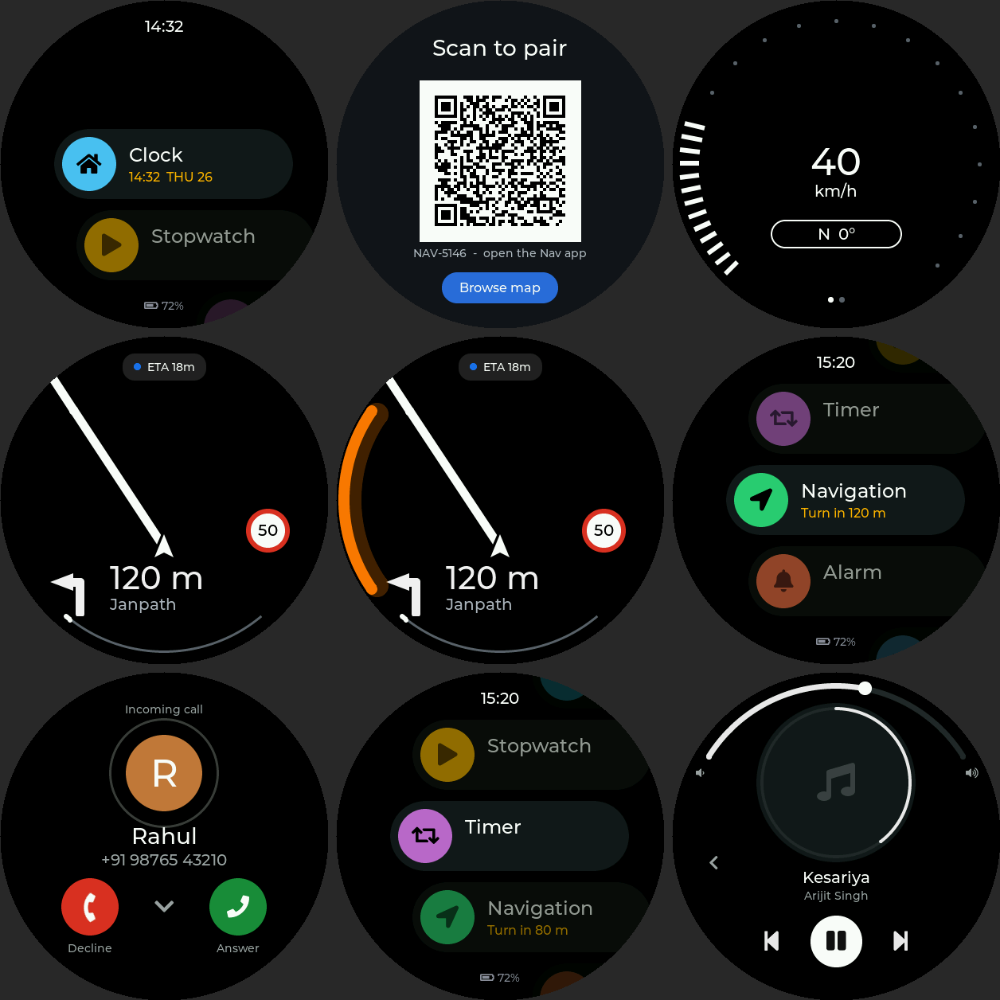
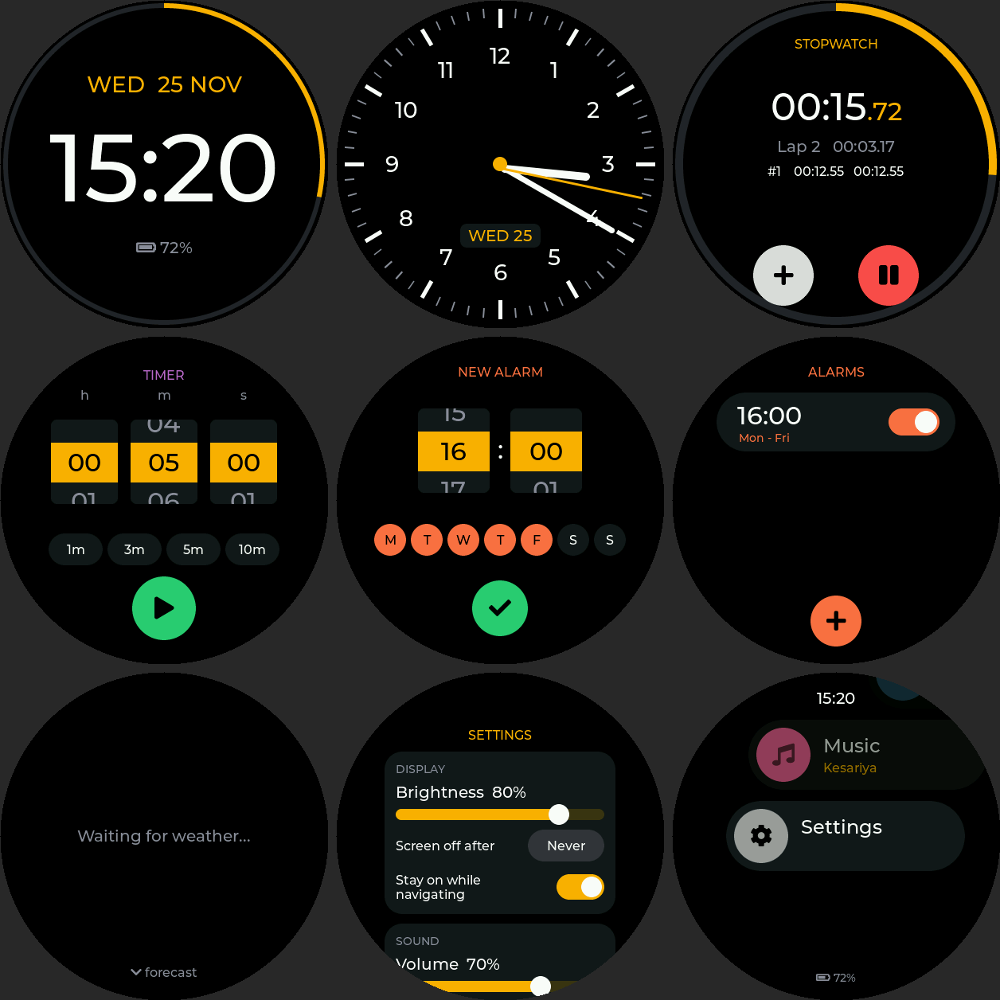

# bike-os v0.6

Multi-app firmware for the **Waveshare ESP32-S3-Touch-LCD-1.46** (412×412 round, SPD2010 QSPI panel and touch, 16 MB flash, 8 MB PSRAM).
**ESP-IDF 5.5.2, LVGL 9.6.**

v0.5 uses **your firmware_ws146 navigation system**: map, minimal BLE street display, turn banner, orange turn edge, media, calls and QR pairing. It runs as the Navigation app, and your board layer (display, touch, SD, power latch) runs underneath every app.







## New in 0.11.1 (night design, ride clock, flyover and tunnel badge)

- **Rides count again.** The ride was restarting on every fix: `ride_tick` used the GUI
  loop's start time while `ride_on_fix` stamped a later one, and the unsigned difference
  wrapped. Times are now compared signed (`since()`), with a fresh `now_ms()`.
- **Night design** (`bos_style.h` holds the palette and fonts): a full-screen turn card with a
  progress ring, a green arrow, big distance, street and green ETA; an Arrived screen; a Cruise
  face (speed, heading-up compass ring, limit, clock, battery); a restyled compass; a 2×2 ride
  stats grid; Now playing in blue; streets drawn with a soft glow on the map.
- **Flyover and tunnel badge.** A step whose words take a flyover ("TAKE FLYOVER", blue),
  stay below one ("STAY BELOW", amber: "avoid the flyover", "service road") or go through a
  tunnel ("TUNNEL", grey) gets a small round badge by the arrow on the turn card, and at the
  banner's right end when no "then" turn is shown (`road_kind` in `nav_view.c`).
- **Windows simulator**: `tools-sim/build_win.sh` builds a host simulator with MinGW, and
  `sim_design.c` renders every new screen to `tools-sim/out/d_*.ppm`. The simulated clock
  moves within a GUI loop (`g_time_creep_us`), as the board's does.

## New in 0.10.1 (screen, rides, About; no Wi-Fi)

- **The screen times out with the phone connected.** Every message from the phone
  woke the screen, and Vela sends its turn state every second, so the screen-off
  timeout never ran. Now only a drive starting or its next turn changing, a new
  track or play/pause, the phone connecting, a command (not the keep-alive ping) and
  a ringing call wake it (`nav_core.c`).
- **PWR on the home screen turns the screen off**; a tap or PWR wakes it, and the
  waking tap reaches no app (`app_manager.c`).
- **Rides measure only accurate fixes.** A coarse network fix (the phone's fix flag
  off, accuracy worse than 50 m) jumps about: counted, it added distance while
  parked, started and ended rides by itself and saved a 2.2 km "ride" with one
  point. Now it only says the phone is there. A hop faster than 160 km/h is a bad
  fix; slow drift after a long gap adds nothing; a long gap crossed at riding speed
  (a tunnel) counts. Auto-start is 10 km/h for 15 s (was 15 km/h for 20 s). The
  compass and the trip distance use the same motion, so they follow (`ride.c`).
- **Settings > About**: board (chip, cores, flash, PSRAM, display, Bluetooth
  address), memory and storage (RAM and PSRAM free of total, app of its partition,
  rides storage, SD card type, capacity, free space and clock), sensors (battery,
  PCF85063 clock, QMI8658 temperature, acceleration and rotation, chip temperature,
  touch, speaker) and firmware (version, IDF, build date, uptime, last start). The
  QMI8658 is on only while About is open (`about.c`).
- **No Wi-Fi, no Weather app.** On this board a running Wi-Fi left ~7 KB of internal
  RAM and the panel's SPI transfers then failed ("spi transmit (queue) color
  failed"): the screen froze. It had never run before (an empty SSID let the
  compiler drop the whole stack). Wi-Fi, lwIP, TLS, the Weather app and its icons
  are gone; the app is 1.64 MB (was 2.40 MB).
- `CONFIG_BIKEOS_DEBUG_DIAG` (off) logs fixes, speeds, the ride, rides storage, the
  screen's idle time and timeout, and free RAM every 5 s. Dev aid only (AGENTS.md
  rule 2).

## Turn card (Follow Google Maps)

- A drive flagged turn only (`NAV_F_TURN_ONLY`, bit 3 of the STATE flags) has no
  route line: the phone is following another app's navigation (Vela's "Follow
  Google Maps", Settings > Nav device). The route face then shows a full-screen
  turn card in place of the map: a large arrow, the distance (blank while the
  phone has none, at the start of a trip), the street over two lines, and
  "ETA 16:16 · 1h 12m · 234.5 km". Laid out in real panel pixels against the
  circle. The card takes no touch, so swipes still reach the other faces, and
  it hides on them like the banner. `nav/nav_view.c`.

## New in v0.10 (long routes)

- The route line holds 2048 points (was 512), in PSRAM, each projected once
  per route instead of every frame. With 512 the phone smoothed a long route
  by up to 80 m to fit it, so the line drifted off the roads and the marker
  snapped to the wrong stretch.
- The route chunk queue holds 72 chunks (was 8, in PSRAM): a burst of chunks
  could overflow it, and one lost chunk threw the whole route away.
- A resent route is picked up where you were along it (no jump to a return
  leg that runs beside the way out); the local search window is wider.
- The off-route "rejoin" search runs once per GPS fix, not per frame.
- Vela sends this since sonu6084/esp32-vela#1 (full detail for the next 20 km,
  resent every 8 km); firmware_v2 and firmware_watcher keep 2048 points too.
- `tools-sim/sim10.c`: 2048-point route, resend, out-and-back route.

## New in v0.9 (ride recording + compass fixes)

- Taps on the navigation pages count up to 40 px of finger wander (was 16 px:
  the SPD2010 centroid moves more than that, so "Start ride" ignored taps).
- Ride distance, moving time, auto-start and the speedometer also work when the
  phone sends no speed (Android fixes without hasSpeed()): speed is worked out
  from position change, in 15 m steps so GPS drift while parked adds nothing.
- A ride never auto-stops while a route is running; parked 10 min without a
  route still ends and saves it.
- Stopping says what happened: "Ride saved", "Under 50 m: not saved", or
  "Can't save: flash full image" (no rides partition). The Rides app shows the
  same, and "Storage missing" if /rides is not writable.
- Compass page: the heading is the GPS course (the board has no magnetometer),
  so it shows only while moving (held 10 s after stopping), else "--" and
  "Ride to see heading". The odometer is labelled RIDE (recording) or TRIP.
- `tools-sim/sim9.c`: jittery tap, phone without speed, parked drift, GPS jump.

## New in v0.8 (intro + home screen)

- Boot intro: `main/assets/intro.gif` plays once at power-on (rev-counter ring
  sweeps into the red, SUZUKI / GIXXER slides in). A tap skips it. Replace the
  file with any 412x412 GIF and rebuild to use your own; `tools/make_intro_gif.py`
  makes the default. A missing or broken GIF never holds the boot.
- Home screen after the intro: big time, date, phone link, battery, seconds
  ring round the rim. Tap anywhere (or BOOT) -> menu.
- Menu -> home: PWR tap, swipe right, 30 s untouched, or the screen sleeping.
  App -> menu: PWR tap or swipe right (as before).
- A route starting opens Navigation from home, the menu or any app. With a
  route running and Navigation closed, home shows a green "Navigating" pill.
- `tools-sim/sim8.c` checks the intro decode/timing/skip and every home path.

## New in v0.7 (swipe fix)

- Swipes between the navigation pages work on the board. The SPD2010 touch chip
  is polled every 10 ms; a poll between two of its reports came back as "no
  finger", LVGL saw a lift, and every swipe was cut into short presses.
  `main/nav/touch_filter.h` now holds the finger down through gaps and reports
  the lift 60 ms after the last point. This also steadies long-press, menu
  scrolling and the music page's swipe back.
- A swipe that slides into the bezel ring is held at the edge instead of lifted.
- Swipe direction is phone-style: right-to-left goes to the next page,
  left-to-right goes back. Left-to-right on the first page opens music; a
  right-to-left swipe on music comes back.
- Fixed: coming back from music could switch off the minimal display (the
  rebuilt map took the finger still down as a long press).
- Page swipe: 50 px sideways and sideways beats vertical 3:2 (was 70 px, 2:1).
- `tools-sim/sim7.c` replays a thumb swipe with chip-like empty polls: fails
  without the filter, passes with it.

## New in v0.6 (Beeline Moto II features)
| Beeline screen | bike-os |
|---|---|
| Turn-by-turn | **New layout (minimal display):** street name and *ETA time · minutes · km* at the **top**, turn arrow and a large distance at the **bottom**. Nearby streets are brighter and wider (major roads 7 px, minor 4 px) and show further out. |
| Speedo | your speedometer face (unchanged) |
| Journey progress | Restyled ETA face: big remaining time, *now → arrival* clocks, km left, a progress ring with a destination pin |
| Journey tracking | **Compass face**: heading-up ring with N/E/S/W and a red marker, heading in degrees, odometer digits (ride distance), clock |
| Ride summary + Start ride | **Ride face**: *Start ride* (tap), live REC time / distance / moving average, *tap twice to end*, a check mark when saved. Rides also start by themselves when a route starts or after 20 s above 15 km/h, and end after 10 min standing still. |
| Route saved for review | **Rides app**: list of saved rides and a detail page with the route trace (green start, red end), distance, time, average and top speed. Stored on a new 2 MB `rides` FAT partition (30 rides, 4000 points each). |
| Rejoin route | Off route, marching dots lead from you to the nearest point of the route, and the banner shows the distance to it. |
| Waypoints 1/3 | **Waypoint face** (shown when the trip has stops): *1/3 waypoints*, next stop name, distance and time. Needs the phone to send the `NAV_STOPS` (0x09) message, which Vela does since sonu6084/esp32-vela#1. |

Faces swipe in this order: route → speed → journey progress → waypoints → compass → ride → phone (left of the route is music, as before).

### Fixes to the 1.46 port found on the way (marked `bike-os fix` in `map_view.c`)
- **Rotated view centre.** The heading-up rendering (marker, route, roads, rotated tiles, circle clip) used 239.5 / 240, the 480 px panel's centre and radius, while the view origin used 206. While riding (map heading-up) everything sat about 34 px right of and below centre. It now uses the panel's centre.
- **Road fade grid overflow.** `ROAD_GRID` was 412 / 8 = 51, rounded down, so roads near the right and bottom edges read past the grid (ASan: global-buffer-overflow). It now rounds up.

## What came from firmware_ws146

| | |
|---|---|
| `main/nav/` | Your files. Changes since v0.5 are marked `bike-os` / `bike-os fix`: `map_view.c` (face hooks, rejoin line, centring and grid fixes, road styling), `nav_view.c` (top/bottom layout, rejoin distance), `ble_service.h` + `ble_nav.c` (`NAV_STOPS`). Unmarked code is as uploaded (board, lcd, touch, sdcard, display, settings, tiles, map_view, nav_view, media_view, media_art, call_view, turn_edge, boot_view, ui_pair, ui_common, ble_nav, ble_service.h). |
| `main/nav_core.c` | Your `main.c`, split in two. The BLE callbacks, queues, `process_events()`, `handle_cmd()`, route assembly, unpair, theme, minimal and brightness handling are copied verbatim. Changes are marked `bike-os` in the source. |
| `sdkconfig.defaults` | Yours, plus a bike-os section at the end. |
| Boot | Your start-up animation plays, then the bike-os menu appears. |

**What `nav_core` changes compared with your `main.c`:**
- **Navigation keeps running behind other apps.** `nav_core_poll()` runs every GUI loop, so BLE state stays current while Clock or Timer is open. The map, pair, media and call screens are built only while Navigation (or Music) is open.
- **A route starting opens Navigation by itself**, from any app.
- **An incoming call opens Navigation on the call screen** from any app except pairing. When the call ends, you return to the app you were in.
- **Music is a menu entry**: your media page, opened directly.
- **The orange turn edge shows only over the map and media pages**, never over the other apps.
- **The phone's clock sets the board's RTC**, which the Clock, Timer and Alarm apps read.
- **Power is handled by bike-os:** PWR key, screen-off timeout (Settings) and deep sleep (`CONFIG_NAV_SLEEP_ENABLE` is off). Your map's "tap again to sleep" still plays your sleep animation. PWR hold 3 s powers off, or deep-sleeps on USB as in your code.
- **BOOT hold 5 s unpair is gone** (BOOT is the app button now). Use **Settings > Forget phone**, the pairing pill's long hold on the map, or unpair from the phone.

## Apps
| App | |
|---|---|
| Clock | Digital (120 px) and analog (`lv_scale`) faces; set time/date |
| Stopwatch | Laps, best/worst, runs in the background |
| Timer | H:M:S rollers, presets, "Time's up" alert over any app, +1 min |
| **Navigation** | firmware_ws146: pairing, map / minimal display, banner, edge, limit, calls |
| Alarm | 6 alarms, weekdays, snooze |
| **Rides** | saved journeys: list, trace, stats; start / end a ride |
| **Music** | firmware_ws146 media page: phone's player over BLE, volume, skip, art |
| Settings | Brightness (shared with the phone app), volume, screen-off, stay on while navigating, set time, forget phone, About (board, memory, storage, SD card, sensors, firmware) |

## Controls
| Where | Input | Action |
|---|---|---|
| Any app | **PWR** tap | menu |
| Most apps | swipe right | menu. **Not in Navigation/Music**: there the map pans and the media page has its own swipe. |
| Navigation | **BOOT** tap | recentre, or from Music back to the map |
| Navigation | **BOOT** hold | map / minimal display (same as your long press) |
| Navigation | your gestures | unchanged: pinch / +/− zoom, drag to pan, long press, pill, double-tap sleep |
| Alerts | ✓ / **BOOT** / **PWR** tap | dismiss; BOOT hold = snooze / +1 min |
| Anywhere | **PWR** hold 3 s | power off (battery) / deep sleep (USB) |

Other app keys are unchanged from v0.4.

## Build
The four registry packages (lvgl 9.6, esp_jpeg, esp_lcd_spd2010 2.0.0, esp_lcd_touch_spd2010 2.1.0) come from the component manager (`main/idf_component.yml`), as for firmware_v2 and firmware_watcher. The first build needs network access.
```bash
source ~/.espressif/tools/activate_idf_v5.5.2.sh
idf.py set-target esp32s3        # first time
idf.py menuconfig                # Nav v2 options as before; bike-os > diagnostic line
idf.py build flash monitor
```
The partition table has a `rides` partition the original firmware_ws146 lacks, so flash the whole image once (`idf.py flash`), not just the app. Remember AGENTS.md rule 1: delete `sdkconfig` after changing `sdkconfig.defaults`.

The zip this came from vendored the packages in `components/` to build offline. That needed two small edits (the SPD2010 components' `cmake_utilities` version macros set in their CMakeLists, and `esp_lcd_touch_spd2010` declaring `esp_lcd_touch` in REQUIRES); with the component manager neither is needed.

**Baseline check:** your untouched firmware_ws146 builds here at 1,339,664 bytes. The app inside your `nav-ws146-merged_4.bin` is 1,339,504 bytes, so this is the same code.

## Layout
```
main/
  nav/                firmware_ws146, unchanged
  nav_core.c/.h       your main.c split for multitasking (see above)
  main.c              your init order + bike-os init + GUI loop (touch poll -> nav_core_poll -> lv_timer_handler)
  sys.c  rtc.c        PWR/BOOT keys via board_*, battery ADC (GPIO8), PCF85063 on your i2c_master bus
  cfg.c               bike-os settings (NVS "bikeos"); pairing/brightness stay in nav/settings.c (NVS "nav")
  app_manager.c       menu, app lifecycle, alerts first on keys, screen timeout
  audio.c alert.c ui_*.c about.c (Settings > About)
  apps/               clock stopwatch timer alarm rides settings_app nav_app(Navigation + Music) registry
  fonts/ icons/       generated by tools/make_font.py and tools/make_icons.py (LVGL 9 format)
tools-sim/            host simulators: build.sh (v0.5 integration, 20 checks) and build6.sh (v0.6 layout, faces, rides, rejoin, waypoints), ASan/UBSan
```

## Things to check on the hardware first
1. Boot animation, then the menu. Touch lands where you tap (your bring-up checklist items 1–2 apply unchanged).
2. Pair with the Vela app. Start a route while in Clock: Navigation should come to the front.
3. A call while in Timer: the call screen appears; after it, Timer comes back.
4. The RTC (PCF85063 at 0x51) now shares your `i2c_master` bus. Clock should show the phone's time after connecting.
5. Battery % in the menu (GPIO8 divider, Waveshare scaling).
